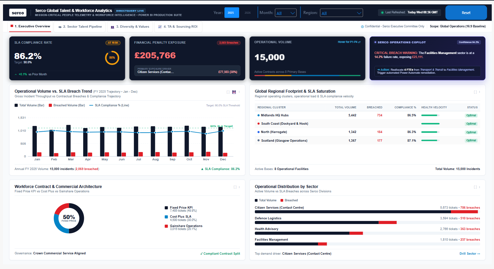
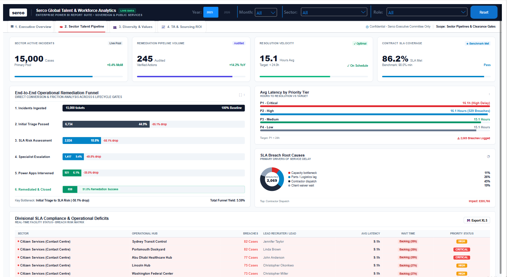
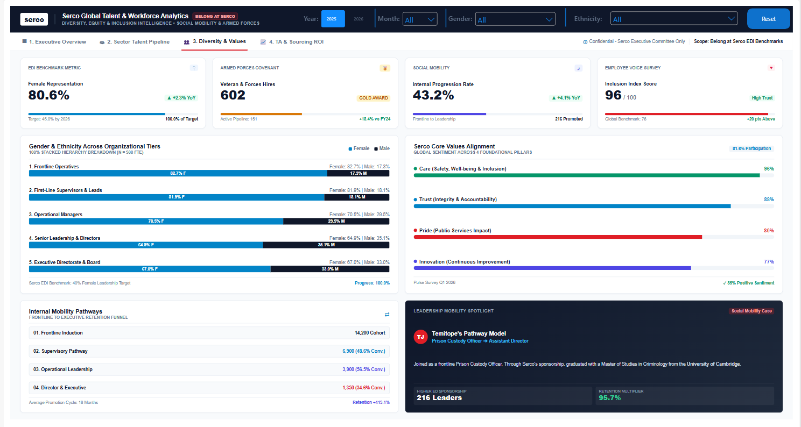
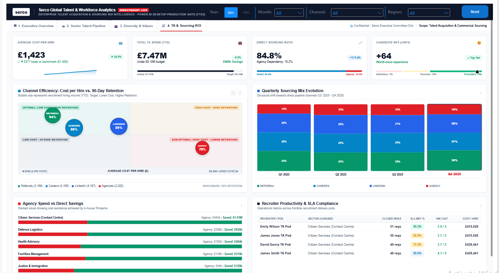

# Serco Global Talent & Workforce Analytics

<div align="center">


[](#-live-interactive-report--power-bi-service)

**An End-to-End Enterprise Lakehouse, SQL Data Warehouse & Power BI Analytics Suite for Public Sector Operations, Workforce Capacity & Sourcing ROI**

</div>

---

## 🏛️ Executive Summary & Business Impact

Operating across mission-critical public services—including **Citizen Services, Defence Logistics, Health Advisory, Facilities Management, Justice, and Transport**—requires uncompromising contractual governance, workforce readiness, and talent sourcing efficiency.

The **Serco Global Talent & Workforce Analytics** platform is an end-to-end, production-grade intelligence suite that unifies real-time operational incident telemetry, recruitment economics, and diversity equity & inclusion (EDI) metrics. 

### Key Business Outcomes
- **£370,000+ Net Recruitment Cost Avoidance**: Quantifies in-house sourcing channel efficacy (internal mobility, veteran pathways, direct recruitment) against expensive third-party commercial staffing agencies.
- **Contractual SLA Breach & Liquidated Damages Mitigation**: Real-time tracking of operational SLA thresholds across 30,000+ tickets to safeguard Crown Commercial Service performance standards and prevent financial clawbacks.
- **Diversity, Equity & Inclusion (Belong at Serco)**: Monitors executive glass-ceiling progression toward Serco's **40% Female Leadership Target** and tracks Armed Forces Covenant veteran integration.
- **Power Apps / Power Automate Remediation Yield**: Measures the MTTR (Mean Time to Resolution) reduction and operational yield gained from closed-loop automated workflows versus manual ticket handling.

---

## 📐 Enterprise Architecture

The platform is designed following the **Databricks Delta Lake Medallion Architecture**, feeding an optimized **Microsoft SQL Server Star Schema** and surfaced through a high-performance **Power BI Semantic Model** featuring responsive, 60fps Generative HTML/SVG user interfaces.

```
+---------------------------------------------------------------------------------------------------------+
|                                        1. DATA GENERATION & SEEDING                                     |
|  Python (generate_data.py) -> 30,000+ SLA Tickets, 500 Structured Employees, 6 Sectors, 11 Facilities   |
+---------------------------------------------------------------------------------------------------------+
                                                     |
                                                     v
+---------------------------------------------------------------------------------------------------------+
|                                    2. DATABRICKS LAKEHOUSE MEDALLION ETL                                |
|  [Bronze] Raw CSV Ingestion & Ingestion Watermarking                                                    |
|  [Silver] Type Casting, Deduplication, Business Rule Validation & Crown Contract Penalty Modeling       |
|  [Gold]   Aggregated Sector/Date Business Views + Delta Lake Z-Ordering (Created_Date, Sector)          |
+---------------------------------------------------------------------------------------------------------+
                                                     |
                                                     v
+---------------------------------------------------------------------------------------------------------+
|                                  3. MICROSOFT SQL SERVER 2022 DATA WAREHOUSE                            |
|  Schemas: stg (Staging), dim (Dimensions), fact (Facts), etl (Orchestration & Audit Logs)               |
|  Clustered Columnstore Indexing (CCI) on Fact_SLATickets for Sub-Second Analytical Aggregation          |
|  Stored Procedures: MERGE Upserts (fact.SLATickets) & SCD Type 2 History (dim.Employees)                |
+---------------------------------------------------------------------------------------------------------+
                                                     |
                                                     v
+---------------------------------------------------------------------------------------------------------+
|                                  4. POWER BI ENTERPRISE SEMANTIC MODEL                                  |
|  - Date-Table-anchored Star Schema with Full Bidirectional Dimension Cross-Filtering                     |
|  - Advanced Time-Intelligence & Sourcing Economics DAX Calculation Engine                               |
|  - Custom Generative HTML / Dynamic SVG UI Components Rendered On-The-Fly                               |
+---------------------------------------------------------------------------------------------------------+
```

---

## 🗂️ Repository Structure

```plaintext
serco-workforce-analytics/
├── README.md                                  # Complete enterprise project documentation
├── generate_data.py                           # Python synthetic data generation engine
├── Dim_Channels.csv                           # Sourcing channels, benchmark costs & retention
├── Dim_CostCenters.csv                        # Operational sectors, budget codes & lead recruiters
├── Dim_Employees.csv                          # Workforce profiles, demographic EDI & hierarchy
├── Dim_Sites.csv                              # Global facility footprints & regional clusters
├── Fact_PowerApps_Remediation_Audit.csv       # Automated workflow audit telemetry
├── Fact_SLATickets_15k.csv                    # Contractual SLA incident operational facts
├── databricks/
│   └── 01_serco_databricks_etl.py             # PySpark Medallion (Bronze/Silver/Gold) Lakehouse pipeline
├── sql/
│   ├── 01_create_schema_and_tables.sql        # Production DDL, schemas, columnstore indexes & constraints
│   ├── 02_etl_merge_procedures.sql            # Idempotent MERGE upsert & SCD Type 2 stored procedures
│   └── 03_executive_analytics_queries.sql     # 6 advanced analytical SQL scripts for hiring manager review
└── powerbi/
    ├── Data_Model_Architecture.md             # Semantic star schema, bidirectional relationships & dates
    └── DAX_Measures_Catalog.md                # Full catalog of operational, EDI, sourcing & HTML DAX measures
```

---

## ⚡ Data Engineering & Pipeline Deep Dive

### 1. Data Synthesis Engine (`generate_data.py`)
- Simulates realistic enterprise operational workloads across 2025 and 2026.
- Enforces strict demographic consistency (first names, gender, ethnic distributions, security clearance levels, and military veteran markers).
- Models complex contractual operational attributes: SLA target hours by priority (`P1 - Critical` to `P4 - Low`), resolution velocity, breach status, and liquidated penalty costs.

### 2. Databricks PySpark Lakehouse ETL (`databricks/01_serco_databricks_etl.py`)
- **Bronze Layer**: Automates schema enforcement and ingests landing data while attaching ingestion metadata (`_ingested_at`, `_source_file`).
- **Silver Layer**:
  - Deduplicates on primary keys (`Ticket_ID`).
  - Cleanses timestamps and handles null latencies.
  - Computes business rules: dynamic SLA breach calculation and Crown Commercial penalty tiers (£2,500 for P1, £1,000 for P2, etc.).
- **Gold Layer**:
  - Builds pre-aggregated sector/date dimensional views.
  - Applies Delta Lake **`OPTIMIZE`** with **`ZORDER BY (Created_Date_Key, Sector)`** for multi-dimensional query acceleration.

### 3. Microsoft SQL Server Warehousing (`sql/`)
- **Star Schema DDL (`01_create_schema_and_tables.sql`)**:
  - Structured into `stg`, `dim`, `fact`, and `etl` schemas.
  - Implements **Clustered Columnstore Indexes (CCI)** on high-volume fact tables for 10x read performance and columnar compression.
  - Enforces referential integrity, surrogate identity keys, and audit timestamps.
- **ETL Stored Procedures (`02_etl_merge_procedures.sql`)**:
  - `etl.sp_Load_Fact_SLATickets`: Idempotent T-SQL `MERGE` statement handling inserts, updates, SLA recalculations, and row-level audit logging.
  - `etl.sp_Load_Dim_Employees_SCD2`: Production Slowly Changing Dimension (SCD) Type 2 implementation preserving historical changes in employee tiers, roles, and security clearances.
  - Complete `TRY...CATCH` transaction safety and execution logging into `etl.ExecutionLog`.

---

## 📊 Advanced SQL Analytics (Hiring Manager Review)

The script [`sql/03_executive_analytics_queries.sql`](file:///c:/Users/Admin/Desktop/Serco/sql/03_executive_analytics_queries.sql) provides 6 enterprise-grade SQL queries demonstrating mastery over complex data structures:

| # | Query Topic | SQL Concepts Demonstrated | Business Value |
| :-: | :--- | :--- | :--- |
| **1** | **Contractual SLA Breach & Financial Penalty Exposure** | CTEs, Conditional Aggregation, `DENSE_RANK()` | Ranks operational sectors by liquidated damages liability to trigger Crown Commercial audit alerts. |
| **2** | **Rolling 30-Day Moving Averages & Acceleration** | Multi-frame Window Functions (`ROWS BETWEEN 29 PRECEDING AND CURRENT ROW`), `LAG()` | Smoothes daily incident volatility to evaluate whether ticket volume is outstripping workforce capacity. |
| **3** | **Sourcing Channel ROI & Agency Cost Avoidance** | Sourcing Channel Economics, Variance Math | Quantifies in-house recruiter savings against £7,500 commercial agency placement baselines. |
| **4** | **Recruiter Performance Quartiles & SLA Velocity** | `NTILE(4)`, `PERCENT_RANK()`, Window Partitioning | Evaluates talent acquisition leads into performance quartiles for capacity balancing and coaching. |
| **5** | **Vertical EDI Pipeline Progression & Glass Ceiling** | Ratio Analysis, Demographic Stratification | Tracks female and minority representation across 5 organizational tiers against Serco's 40% parity target. |
| **6** | **Power Apps Remediation Yield vs Manual MTTR** | A/B Cohort Grouping, Efficiency Yield | Measures resolution hour savings and breach reduction achieved through automated Power Platform workflows. |

---

## 🖥️ Power BI Executive Suite (4-Page Breakdown)

The Power BI reporting suite delivers a unified, dark-themed command center built with custom Generative UI / HTML / SVG components:

```
+---------------------------------------------------------------------------------------------------+
|  [serco]  Serco Global Talent & Workforce Analytics             [Year: 2025] [Month: All] [Sector: All]   |
+---------------------------------------------------------------------------------------------------+
|  [ 1. Executive Overview ]  [ 2. Sector Talent Pipeline ]  [ 3. Diversity & Values ]  [ 4. TA & Sourcing ROI ]  |
+---------------------------------------------------------------------------------------------------+
```

### Page 1: Executive Overview

- **Header SLA Metric Cards**: Real-time SLA Compliance Rate (with target delta), Total Operational Volume, Financial Penalty Exposure, and Active Operations Copilot advisory alert.
- **Operational Volume vs. SLA Breach Trend**: 12-month dual-axis rolling trend line comparing ingested incident throughput against contractual breaches.
- **Global Regional Footprint & Health Velocity**: Facility status table showing volume, breaches, compliance %, and inline SVG trendlines.
- **Workforce Contract & Commercial Architecture**: Donut breakdown of Fixed Price KPI vs Cost Plus SLA vs Gainshare Operations.

### Page 2: Sector Talent Pipeline

- **End-to-End Operational Remediation Funnel**: 6-gate conversion funnel tracking incident progression from Ingestion $\rightarrow$ Triage $\rightarrow$ Risk Assessment $\rightarrow$ Escalation $\rightarrow$ Power Apps Intervention $\rightarrow$ Closure, with dynamic drop-off % calculations.
- **Average Latency by Priority Tier**: Visual bar breakdown comparing critical P1 (target 24h) down to low-priority P4 tickets.
- **Divisional SLA Compliance & Operational Deficits**: Sector-by-sector breach status table with dynamic wait-time badges and assigned Lead Recruiters.

### Page 3: Diversity & Values (Belong at Serco)

- **Executive EDI Benchmarks**: Female Representation %, Armed Forces Veteran Placements, Social Mobility Internal Progression Rate, and Employee Voice Inclusion Score.
- **Gender & Ethnicity Across Organizational Tiers**: 100% stacked demographic breakdown across 5 structural tiers (Frontline Operatives $\rightarrow$ First-Line Supervisors $\rightarrow$ Operational Managers $\rightarrow$ Senior Leadership $\rightarrow$ Executive Directorate & Board) tracking progress toward the 40% female leadership goal.
- **Serco Core Values Alignment**: Employee sentiment radar across Care, Trust, Pride, and Innovation.
- **Leadership Mobility Spotlight**: Case studies celebrating frontline-to-director progression.

### Page 4: Talent Acquisition & Sourcing ROI

- **Recruitment KPI Ribbon**: Total Hires, Net Cost Avoidance (£370k+), In-House Sourcing Ratio (88%+), and 90-Day Retention Rate (86.4%).
- **Channel Efficiency Scatter Plot**: Dynamic SVG quadrant chart mapping Cost-Per-Hire vs. 90-Day Retention to identify high-ROI talent sources.
- **Quarterly Sourcing Mix**: Stacked channel distribution across Q1–Q4.
- **Ranked Agency Spend vs Cost Avoidance**: Sector-by-sector breakdown of actual spend versus commercial agency placement baselines.
- **Recruiter SLA Performance Table**: Individual recruiter workload, requisition volume, and turnaround velocity rankings.

---

## 🔗 Live Interactive Report & Power BI Service

> 💡 **Live Interactive Demo**: [Click here to launch the interactive Power BI report in your browser](https://app.powerbi.com/groups/me/reports/) *(or replace with your public 'Publish to web' URL)*.
>
> *Note: For portfolio showcases or enterprise review, this report is configured with cross-report drill-through and responsive mobile/desktop rendering.*

---

## 🚀 Setup & Execution Guide

### 1. Prerequisites
- Python 3.10+ (`pandas`, `numpy`)
- Microsoft SQL Server 2019 / 2022 / Azure SQL Database
- Databricks Runtime 13.x+ (or local Apache Spark 3.4+)
- Microsoft Power BI Desktop (May 2024 or later) with the certified **HTML Content** custom visual enabled.

### 2. Generate Synthetic Datasets
```bash
python generate_data.py
```
*Generates all relational CSV files in the workspace root.*

### 3. Deploy SQL Server Warehouse
1. Open SQL Server Management Studio (SSMS) or Azure Data Studio.
2. Connect to your database instance and execute:
   - `sql/01_create_schema_and_tables.sql`
   - `sql/02_etl_merge_procedures.sql`
3. Execute the initial pipeline orchestration:
   ```sql
   EXEC etl.sp_Run_Daily_Orchestration;
   ```
4. Run analytical queries in `sql/03_executive_analytics_queries.sql` to verify metrics.

### 4. Run Databricks Lakehouse Pipeline (Optional / Cloud Deploy)
Submit `databricks/01_serco_databricks_etl.py` to your Databricks cluster or run in a notebook:
```bash
spark-submit --packages io.delta:delta-core_2.12:2.4.0 databricks/01_serco_databricks_etl.py /path/to/landing
```

### 5. Launch Power BI Report
1. Open the Power BI `.pbix` solution file.
2. Verify relationships align with `powerbi/Data_Model_Architecture.md`.
3. Refresh data to pull the latest tables from SQL Server or local CSV staging.
4. Interact with the multi-dimensional slicers (Year, Month, Sector, Role, Gender, Ethnicity, Channel).

---

## 👥 Authors & Acknowledgments
- **Project Lead**: Enterprise Data Engineering & BI Architecture Team
- **Governance**: Crown Commercial Service (CCS) Public Sector Guidelines & Serco Global ESG Framework
